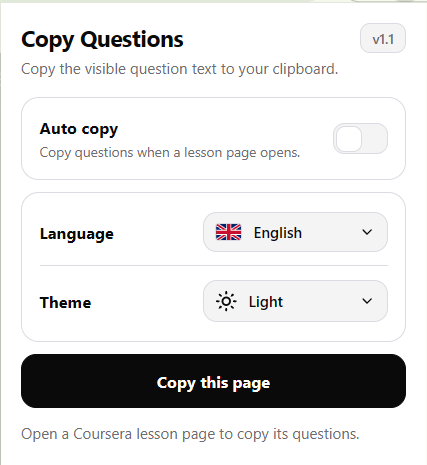
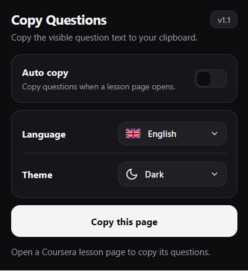

<div align="center">
  
  <h1>Coursera Questions Copy</h1>
  <p>A browser extension that extracts questions from Coursera quizzes and assignments and copies them to the clipboard as structured JSON for study notes, revision, and review.</p>

  <p>
    <a href="README.md"><b>English</b></a> | <a href="README.vi.md"><b>Tiếng Việt</b></a>
  </p>

  <p>
    
    
    
  </p>
</div>

---

## Overview

I developed this project to make working with Coursera question content more convenient and efficient, especially when preparing study notes and reviewing course materials.

By converting questions into structured text instead of relying on screenshots, the extension makes content easier to copy, organize, and reuse with a wide range of large language models (LLMs). Text-based input may also reduce token usage compared with image-based input, depending on the model and context.

## Preview

<div align="center">
  <table>
    <tr>
      <td align="center">
        <b>Light Mode</b><br/><br/>
        
      </td>
      <td align="center">
        <b>Dark Mode</b><br/><br/>
        
      </td>
    </tr>
  </table>
</div>

---

## Features

- **Auto Copy:** Automatically copies questions to the clipboard when a supported assignment page loads.
- **Manual Copy:** Copies questions on demand through a button in the extension popup.
- **Structured JSON:** Organizes questions, answer choices, and question types into clean, readable JSON.
- **Math and Diagrams:** Formulas are copied as their LaTeX source between `$` signs, and pictures are copied as markdown image links that point to the original file, so questions containing equations or figures are not lost.
- **LLM-Friendly Workflow:** Makes extracted text easy to paste into different LLMs or personal note-taking tools, without requiring screenshots.
- **Bilingual Interface:** Supports English and Vietnamese across the popup and in-page notifications.
- **Theme Support:** Follows the system theme or allows manual Light/Dark selection.
- **Lecture Video Completion:** Marks the lecture videos of the course you are on as completed. It reads the course outline, then sends the playback events the web player itself would send, one lecture at a time, and checks what Coursera answers back before it counts a lecture as done.
- **No Third-Party Servers:** Nothing leaves Coursera. The copy tool works entirely inside the page, and the video completion calls Coursera's own API with your own signed-in session.

---

## Installation

1. Clone or download this repository.
2. Open Chrome or any Chromium-based browser and navigate to `chrome://extensions/`.
3. Enable **Developer mode** in the top-right corner.
4. Click **Load unpacked** and select the extension directory.
5. Open a supported assignment page on Coursera.

---

## Settings

Click the extension icon in the toolbar to access the configuration options.

| Setting | Description |
| :--- | :--- |
| **Auto copy** | Automatically copies questions when a supported lesson or assignment page loads. |
| **Language** | Switches the interface and in-page notifications between English and Vietnamese. |
| **Theme** | Selects Follow system, Light, or Dark theme. |
| **Copy this page** | Manually copies questions from the current active tab. |
| **Complete lecture videos** | Marks the lecture videos of the course in the current tab as completed. |

---

## JSON Output Format

Extracted questions are placed on the clipboard in the following format:

```json
[
  {
    "questionNumber": 1,
    "type": "single_answer",
    "question": "A type of artificial intelligence that outperforms humans in some defined task is known as",
    "options": [
      "AEI",
      "Special AI",
      "General AI",
      "Narrow AI"
    ]
  }
]
```

Recognized question types:

- `single_answer`
- `multiple_answer`
- `essay`
- `text_input`
- `code_expression`

Questions that contain formulas or pictures are copied the same way, with the formula source and the image address kept inline:

```json
[
  {
    "questionNumber": 3,
    "type": "single_answer",
    "question": "Are the following vectors linearly independent?\n\n$\\mathbf{a} = \\begin{bmatrix} 1 \\\\ 0 \\\\ 1 \\end{bmatrix}$, $\\mathbf{b} = \\begin{bmatrix} 2 \\\\ -1 \\\\ 1 \\end{bmatrix}$\n\n",
    "options": [
      "Yes",
      "No"
    ]
  }
]
```

The image address belongs to Coursera's content delivery network, which serves the file only to a signed-in session, so opening a copied link works in a browser that is logged in to the course.

The output can be pasted into compatible LLM interfaces, text editors, or note-taking applications for further study and review.

---

## Project Structure

```text
icons/             Extension icon files
pics/              Interface preview images
manifest.json      Manifest configuration (MV3)
content.js         DOM parsing, clipboard operations, and notifications
video.js           Lecture video completion module
popup.html         Popup structure
popup.css          Popup styles
popup.js           Popup logic and settings storage
README.md          English documentation
README.vi.md       Vietnamese documentation
```

---

## Development and Contributions

This project was developed with AI assistance using a *vibe coding* workflow and is actively maintained.

I aim to keep the project up to date, and additional features or improvements may be introduced in future releases.

If you encounter a bug or have an idea for an improvement, please submit a **Pull Request** with relevant details so I can investigate the issue and work on a solution.

Contributions, suggestions, and feedback are welcome.

Have fun!

---

## Notes

The lecture video completion marks videos as completed without watching them. That is an automated way of finishing course work, and it does not meet the Coursera Honor Code, so use it only where that is allowed. This project is for education and research, it does not condone cheating, and it comes with no support: if a run fails to start or leaves a course page in a bad state, that is yours to handle.

---

## License

Distributed under the [MIT License](LICENSE).
